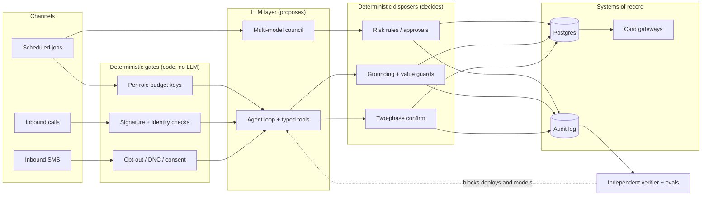

# AI Operator Portfolio

**A sales leader with 20 years in the field who builds and runs production AI systems.**

Travis Vayssie · Enterprise Sales & Revenue Leader

- 20+ years leading sales teams: $10M+/yr at Sentry Servicing, $600K+/mo at Liberty Credit Management.
- Today I design, ship and operate AI agents that take real actions for real customers: they book appointments, handle payments and run back-office work.
- I sell what I build, and I build what I sell. This repo shows the receipts.

The rule behind all of it: **LLMs propose, deterministic code disposes.** The model drafts, reasons and talks. Typed code decides what actually happens: compliance gates, two-phase confirmations, eval gates, budget caps and risk rules the model cannot override.

---

## In production

Every number below comes from a read-only aggregate query or a dated log. The queries are in [`metrics/`](metrics/METRICS.md).

| System | What it does | Verified result | Window |
|---|---|---|---|
| **SaunaticaOS** | Self-built CRM, booking, billing and payments platform for a wellness studio. Replaced GoHighLevel + Hapana | **$97K processed natively across 963 payments.** 9,985 customers and ~57K sessions migrated and managed. 85-model schema, 318 API routes, 970 commits, 10 live automation workflows (9,122 runs) | 2026-05-21 → 2026-10-20 |
| **Sarah AI** | 24/7 SMS and voice AI receptionist that transacts against the live schedule | **382 sessions booked autonomously for 196 customers** (63% completed). **2,873 AI-handled SMS turns across 631 contacts.** **182 inbound voice calls answered** | May → Oct 2026 |
| **Governed agent ops** | Budget-capped, eval-gated, compliance-checked team of role agents for a lead-gen business | 4,486 ok / 6 suspicious / 2 failed dispatcher runs, 4 automatic suspensions. 673 model-eval runs. Independent Verifier: 72 outcome checks, 86.9% of results passing | 2026, as of 2026-10-20 |
| **Multi-LLM trading committee** | Engineering showcase: 3-model council, veto-only arbiter, deterministic risk engine | **Paper-traded only. No alpha claimed.** Paper NAV −0.95% over ~4 weeks, max drawdown −7%, 35% win rate on 205 trades vs a 46.8% break-even | ~4 weeks, early 2026 |

What these numbers do **not** say: Sarah's figures are bookings and conversations, not revenue. No payment figure is attributed to Sarah. The trading system never touched live capital.

---

## How the pieces fit

Five detailed diagrams live in [`architecture/`](architecture/).

---

## How I build

1. **Compliance runs before the model.** Opt-outs, do-not-contact lists and identity checks are code paths that never depend on model judgment.
2. **Every mutation is two-phase.** The agent proposes; the customer confirms ("Reply YES"); the server executes against a fresh read of the database.
3. **The model never touches money.** The server issues tokenized payment links. Charges are durable before the gateway is called and are reconciled every 5 minutes.
4. **Evals gate deploys and model choice.** Variance-aware regression checks run production's own code path. A model can only be assigned to a role if its scorecard passes. Cost never affects pass.
5. **Budgets are enforced at the API key, not in a prompt.** Each agent role has its own spend-capped key.
6. **Prove effects, not execution.** A job that "succeeds" but writes nothing is marked suspicious. An independent verifier with no shared code checks outcomes.
7. **Measure honestly, and say what you did not measure.** Retire what the evidence says to retire.

Each principle has a one-page decision record in [`adr/`](adr/).

---

## Case studies

| # | Case study | One-line takeaway |
|---|---|---|
| 01 | [Sarah AI: an AI receptionist that transacts](case-studies/01-sarah-ai-receptionist.md) | 382 autonomous bookings with compliance and confirmation gates the model cannot skip |
| 02 | [SaunaticaOS: replacing GoHighLevel + Hapana](case-studies/02-saunaticaos-replacing-ghl-hapana.md) | Mirror-mode migration, durable payments, $97K processed natively |
| 03 | [Governed agent ops](case-studies/03-governed-agent-ops.md) | Running a team of agents in production without losing sleep |
| 04 | [Multi-LLM trading committee](case-studies/04-multi-llm-trading-committee.md) | Paper-only; the engineering worked and the backtests did not. Both are documented |
| 05 | [PrepareQuick: 0 to 1](case-studies/05-preparequick-0-to-1.md) | A past AI SaaS with RAG, Stripe and a paid-acquisition loop, plus the security fixes I'd make |
| 06 | [Programmatic SEO and the prune](case-studies/06-programmatic-seo-and-the-prune.md) | 13K pages, a scaled-content demotion, and a data-driven prune to 536 |
| 07 | [Killing a strategy with evidence](case-studies/07-killing-a-strategy-with-evidence.md) | Preregistration, 1:1 reconciliation, and a clean retirement at −8.8% |
| 08 | [AI tutor invariants](case-studies/08-ai-tutor-invariants.md) | AI talks, deterministic code grades |

For the go-to-market view, see [GTM for AI agents](talks/gtm-for-ai-agents.md): how I would sell and deploy agents into SMB and enterprise accounts.

---

## Repo map

| Repo | What you'll find |
|---|---|
| [ai-operator-portfolio](https://github.com/Trypto1019/ai-operator-portfolio) (this repo) | Case studies, architecture diagrams, ADRs, metrics and queries |
| [agentic-front-desk](https://github.com/Trypto1019/agentic-front-desk) | Reference SMS/voice agent: opt-out engine, guarded tool registry, two-phase intents, eval harness. Runs offline with a mock model |
| [governed-agent-ops](https://github.com/Trypto1019/governed-agent-ops) | Dispatcher, budget-capped keys, PII filter on tool results, eval-gated model choice, compliance-as-data, verifier, approvals |
| [studio-os-reference](https://github.com/Trypto1019/studio-os-reference) | Durable two-phase payments, reconciliation, webhook security, rate limiting, release engineering |
| [multi-llm-trading-committee](https://github.com/Trypto1019/multi-llm-trading-committee) | 3-model council, veto-only arbiter, deterministic risk engine, debate ranker. Paper and mock data only |

All code repos are clean, fresh-history extracts with synthetic data. The production systems stay private.

---

## Contact

- LinkedIn: [linkedin.com/in/travis-vayssie-4ba7781b9](https://www.linkedin.com/in/travis-vayssie-4ba7781b9)
- Email: [travis.vayssie.jobs@gmail.com](mailto:travis.vayssie.jobs@gmail.com)
- Book a 30-minute call: [calendly.com/travisv-preparequick/30min](https://calendly.com/travisv-preparequick/30min)
- GitHub: [@Trypto1019](https://github.com/Trypto1019)

License: [MIT](LICENSE).
