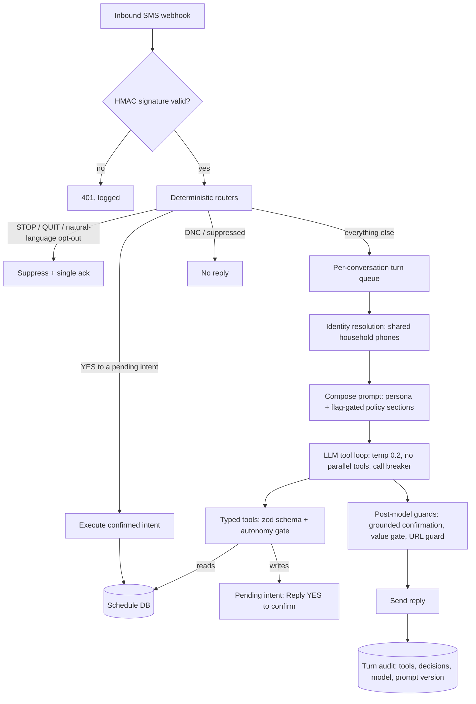

# 01. Sarah AI: an AI receptionist that transacts

**Role:** designer, builder and operator. **Status:** live in production. **Stack:** TypeScript / Next.js, Postgres + Prisma, Claude Sonnet via OpenRouter (SMS), OpenAI Realtime over SIP (voice), zod-validated tools, Python eval harness.

## Problem

A single-location wellness studio gets texts and calls at all hours with a small front-desk team. Missed texts cost intro bookings. Reschedules and cancellations eat staff time.

Most "AI receptionists" answer questions. This one had to **act**: book, reschedule and cancel against the live schedule, without ever saying something untrue about a customer's account, and without breaking opt-out rules.

## Architecture

Voice uses the same tool registry. Calls bridge over SIP to a realtime speech model, and a warm transfer hands the caller to a staff workstation. An audio-level watchdog disables warm transfer automatically if it detects dead air. Diagram: [`architecture/sarah-voice.mmd`](../architecture/sarah-voice.mmd).

## Guardrails and design rules

- **Compliance before the model.** STOP, QUIT, natural-language revocation and do-not-contact checks are a deterministic phrase set. Honoring an opt-out never depends on model judgment. ([ADR 0001](../adr/0001-deterministic-compliance-before-llm.md))
- **Two-phase mutations.** Every booking change becomes a pending intent. Nothing changes until the customer replies YES. ([ADR 0002](../adr/0002-two-phase-confirm-before-mutation.md))
- **Grounded confirmation.** When a customer asks about an existing booking, the server re-reads the database and composes the reply itself. The model's draft is discarded for that turn.
- **Identity before disclosure.** Shared household phones resolve to "no match", "single" or "multiple". A name check comes before any account detail is revealed.
- **Sarah never takes payment.** For one campaign the server, not the model, answers a positive reply with a tokenized payment link. The model cannot emit a URL the server has not allow-listed.
- **Bounded loop.** Low temperature, no parallel tool calls, and a tool-call breaker. Model and limits are database settings, and every turn records the model name and prompt version.
- **AI disclosure** in the first sentence of every voice call.
- **Evals as a deploy gate.** The harness runs production's own code path against scratch databases with frozen tool fixtures and no outbound sends. It combines deterministic checks with an LLM judge. A regression counts only if a check that never failed in a 5-run baseline fails 3 of 3 re-runs. Deploys touching agent code must pass it. ([ADR 0005](../adr/0005-eval-gated-model-selection.md))

## Evidence and metrics

| Metric | Value | Window |
|---|---|---|
| Sessions booked autonomously | **382**, for **196** distinct customers | May → Oct 2026 |
| Of those, completed | **63%** | same |
| AI-handled SMS turns (one inbound text → one AI reply) | **2,873** across **631** contacts | 2026-05-29 → 2026-10-19 |
| Inbound voice calls answered | **182** | 2026-05-28 → 2026-10-19 |
| Revenue attributable to Sarah | **Not measured.** No payment figure is attributed to Sarah | — |
| Staff hours saved | **Not measured** | — |

A turn is one inbound text and the reply it produced, which is a stricter unit than a "conversation." Queries: [`metrics/queries/sarah_*.sql`](../metrics/queries/).

## What I'd do differently

- **Instrument attribution on day one.** I can count bookings, but I cannot cleanly tie revenue to the agent. A booking-source field on every downstream payment would have answered the CFO question.
- **Measure deflection explicitly.** "Turns handled without a human" is the metric a buyer wants. I'd log a per-conversation resolution outcome from the start.
- **Build synthetic eval data first.** Anonymizing real threads is slow and risky. A synthetic golden set with injection cases should exist before the first production turn.

## Business impact (for a sales or GTM leader)

- **Speed to lead at 2 a.m.** A missed text is a lost intro booking. An agent that books on its own, 382 times so far, turns after-hours inbound into revenue opportunities the studio would otherwise lose.
- **Trust is the product.** The two-phase confirmation and grounded replies are why the business kept it switched on. In an enterprise deal this is the security review conversation, and these are the answers.
- **Honest metrics close deals.** I report turns, not inflated "conversations", and I won't attribute revenue I can't prove. That survives a buyer's diligence.
