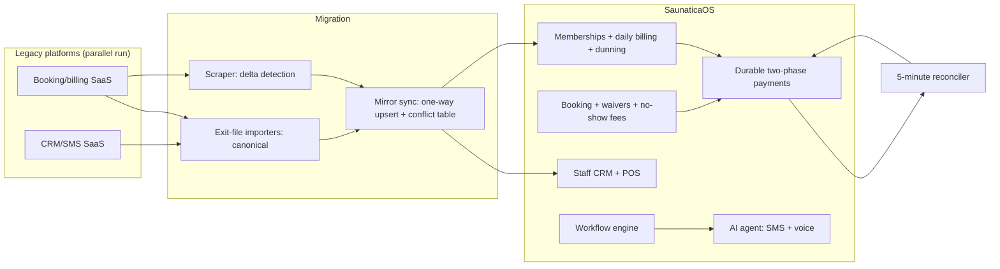

# 02. SaunaticaOS: replacing GoHighLevel + Hapana

**Role:** product owner, architect and sole engineer (built with AI coding agents). **Status:** live in production. **Stack:** Next.js 14, React, TypeScript, Prisma, Postgres 16, two card gateways (a vault-based primary gateway and Stripe), SMS/voice via a CPaaS, Resend, systemd + nginx.

## Problem

A wellness studio ran on two SaaS platforms: GoHighLevel for CRM, SMS and workflows, and Hapana for booking, memberships and billing. Neither had the AI-agent capabilities the business wanted. The studio did not own its customer and payment data in a usable form, and two subscriptions cost money every month.

The goal: replace both with one system the business owns, **without a day of lost bookings or failed renewals**.

## Architecture

Payment detail: [`architecture/studio-os-payments.mmd`](../architecture/studio-os-payments.mmd).

## Guardrails and design rules

- **Mirror mode before cutover.** The old platform stayed the source of truth during a parallel run. Exit files were canonical; a scraper only detected deltas. Conflicts were written to a table for review, never auto-resolved.
- **Card-vault carryover.** Stored payment methods moved with the customers, so renewals continued without asking anyone to re-enter a card. The customer app shipped as an in-place upgrade of the old app listing.
- **Durable charges.** A pending payment row with an idempotency key is written *before* the gateway call. Fulfilment runs under a row lock. Key reuse with a different request body returns 409. ([ADR 0003](../adr/0003-pre-charge-durability-and-reconciliation.md))
- **Reconciliation every 5 minutes.** Stuck pending charges are checked against the gateway. After N attempts they become UNKNOWN and open a staff task. Paid-but-unfulfilled payments are re-fulfilled.
- **Verified webhooks.** Raw-body signature checks on payment, email and SMS webhooks, with timing-safe comparison. An append-only audit row doubles as the idempotency guard.
- **Release identity.** Every cron runs from an immutable release directory, so uncommitted edits can never go live. Service start and post-start hooks verify that the running build matches the intended release. ([ADR 0004](../adr/0004-release-identity-and-immutable-cron-releases.md))
- **Role-based access** (owner / manager / staff) and host-based routing separate staff and customer surfaces.

## Evidence and metrics

| Metric | Value | Window |
|---|---|---|
| Payments processed natively | **$97K across 963 payments** | 2026-05-21 → 2026-10-20 |
| Customers migrated and managed | **9,985** | as of 2026-10-20 |
| Sessions migrated and managed | **~57K** | as of 2026-10-20 |
| Live automation workflows | **10**, with **9,122** runs | as of 2026-10-20 |
| Data model | **85** Prisma models | as of 2026-10-20 |
| API surface | **318** API routes | as of 2026-10-20 |
| Commits | **970** on main | 2026-04-18 → 2026-10-19 |
| SaaS cost avoided | **Not published** | — |

The $97K counts only payments created natively by the new system. Payment history imported from the old platform is excluded. Queries: [`metrics/queries/studio_os_*.sql`](../metrics/queries/).

## What I'd do differently

- **CI from the first commit.** Gating lived in the deploy script (typecheck, build, smoke tests before restart). That works for one operator but not for a team. The public extract adds GitHub Actions.
- **Least privilege from day one.** Services should run as dedicated non-root users with hardened unit files. The reference repo shows that version.
- **Synthetic fixtures only.** Tests should never need a real phone number or email. A hygiene test that fails the build on one is cheap insurance.
- **Config layer for brand and timezone** from the start, instead of literals that later need extraction.

## Business impact (for a sales or GTM leader)

- **Platform displacement is a sales motion.** Ripping out two incumbent SaaS tools needs the same things an enterprise migration does: a parallel run, a rollback story, and zero customer-visible disruption. I've now done it from the vendor side and the operator side.
- **Owning the data unlocked AI.** The agent in case study 01 only works because bookings, memberships and payments live in one schema the agent's tools can read.
- **Reliability is revenue.** Durable payments and 5-minute reconciliation mean no silent failed renewals. That is the difference between churn and retained revenue.
