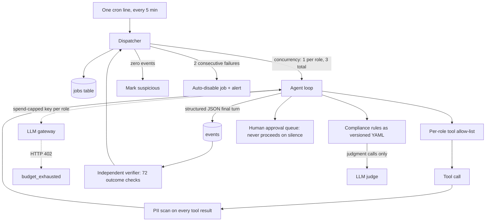

# 03. Governed agent ops: running a team of agents without losing sleep

**Role:** designer, builder and operator. **Status:** live in production. **Stack:** Python, Postgres, OpenRouter (Claude and Gemini families, among others), PyYAML, Playwright, cron.

## Problem

A consumer-loan lead-generation affiliate business had grown about 15 ad-hoc cron jobs and loosely supervised AI scripts: SEO, content, nurture email, finance rollups, compliance checks. Each one could fail silently, overspend on tokens, or publish something non-compliant in a regulated category.

The goal: replace them with **one dispatcher and a team of role agents** (operator, compliance, finance, SEO, writer, nurture, revenue, paid, authority, verifier) that are cheap to run, auditable, and safe to leave alone.

## Architecture

Diagram source: [`architecture/agent-ops-dispatcher.mmd`](../architecture/agent-ops-dispatcher.mmd).

## Guardrails and design rules

- **Budget enforced at the key.** Each role gets its own API key with a spend limit equal to its budget. Exhaustion returns HTTP 402 and is recorded as `budget_exhausted`. The management key is kept off the host.
- **PII firewall.** Every tool result is scanned before the model sees it.
- **Least privilege by host.** The agent host has no credentials for the lead marketplace, mail or CMS. Agents that need those effects go through approvals.
- **Eval-gated model choice.** A role charter can only name a model with a passing scorecard less than 90 days old. Families: fabrication, tool-calling, authority, role quality, PII leakage, consistency, cost/latency. **Cost never affects pass.** ([ADR 0005](../adr/0005-eval-gated-model-selection.md))
- **Compliance as data.** Rules live in versioned YAML. Deterministic checks run first; an LLM is used only for judgment calls and sees the artifact text alone. Each rule traces to a real incident.
- **Prove effects, not execution.** A run that writes zero events is "suspicious", not "ok". The verifier shares no code with the agents, uses no LLM, and checks outcomes such as fresh rows, counts, files and HTTP responses.
- **Shadow mode first.** The lead router ran in shadow mode with consent, state-licensing and sensitive-data rules in code before it was allowed to route anything.
- **Humans approve, and silence is not consent.** Unanswered items re-escalate.
- **Role charters** define each agent's mandate, authority tier, "must never" list, KPIs read from sensors it can't write, and a kill criterion.

## Evidence and metrics

| Metric | Value | Window |
|---|---|---|
| Dispatcher runs | **4,486 ok / 6 suspicious / 2 failed** | 2026, as of 2026-10-20 |
| Automatic job suspensions | **4** | same |
| Model-eval runs | **673** | same |
| Verifier | **72** outcome checks; **86.9%** of recorded results passing | same |
| Token spend saved vs. the old crons | **Not measured** | — |
| Business outcome lift | **Not measured** | — |

The 86.9% is a pass rate over all recorded verifier results, not "86.9% of jobs work". Failing checks are the point: they are how silent breakage gets caught. Source notes: [`metrics/METRICS.md`](../metrics/METRICS.md).

## What I'd do differently

- **Put guardrails in code, not prompts, everywhere.** An earlier weekly maintenance agent relied on written guardrails in its prompt. The v2 design moved every hard rule into code, keys and approvals. I'd start there.
- **Secret scanning and a strict `.gitignore` from the first commit**, with a pre-commit hook that fails closed. Retrofitting hygiene is much more expensive than starting with it.
- **Baseline before migration.** I didn't capture a clean "before" cost and failure rate for the old crons, so I can't quote an improvement percentage.

## Business impact (for a sales or GTM leader)

- **This is the enterprise objection list, answered.** "What if it overspends?" Key-level caps. "What if it leaks PII?" A firewall on tool results. "What if it hallucinates?" Fabrication evals gate the model. "Who approves?" A queue that never proceeds on silence.
- **Outcome verification is what makes an agent sellable.** Buyers don't pay for runs, they pay for effects. A verifier that checks effects is what lets you put an SLA on an agent.
- **Forward-deployed pattern.** This is the deployment playbook I'd bring into a customer: charter, budget, eval, shadow mode, approval, verify.

Code: [governed-agent-ops](https://github.com/Trypto1019/governed-agent-ops).
