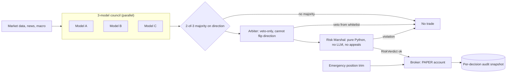

# 04. Multi-LLM trading committee (paper-traded)

**Role:** designer and builder. **Status:** archived; paper account only. **Stack:** Python 3.12, asyncio, Postgres, LiteLLM routing across GPT-4o, Gemini, Grok and Claude, Microsoft Qlib + RD-Agent for Claude-driven factor research, a broker API in paper mode.

> **Read this first.** This system placed orders autonomously, **on a paper account only**. It never traded live capital and it showed **no alpha**. It is here as an engineering showcase and as a lesson in honest measurement.

## Problem

Can a committee of LLMs make disciplined, auditable trading decisions if every decision passes through hard risk rules the models cannot override? And can you measure the result honestly enough to know if it works?

## Architecture

The emergency trim runs *before* the AI layer each checkpoint. Diagram source: [`architecture/trading-committee.mmd`](../architecture/trading-committee.mmd).

## Guardrails and design rules

- **Risk Marshal, in code.** Its header reads "PURE PYTHON. NO AI. NO LLM. NO APPEALS." 5% max position, 20% max sector, a correlation cap, 3 new positions per day, drawdown modes at 5% / 10% / 15% (sell-only at 15%). VIX above 25 halves size; above 35 freezes trading. Output is a typed verdict. ([ADR 0006](../adr/0006-llms-propose-code-disposes.md))
- **Veto-only arbiter.** The final model may block a trade from a whitelist of risk reasons. It may not change direction.
- **Schema-validated agents** with a typed error hierarchy: a parse failure is an error, never a guess.
- **Safe trigger DSL** instead of `eval`. Trailing stops that only ever tighten.
- **Full audit trail:** every input, opinion and decision is snapshotted per checkpoint.

## Evidence and metrics

| Metric | Value |
|---|---|
| Account type | **Paper only** |
| Paper NAV change | **−0.95%** over ~4 weeks |
| Max drawdown | **−7%** |
| Win rate | **35%** on **205** closed trades |
| Break-even win rate at the observed payoff ratio | **46.8%** |
| Alpha | **None demonstrated** |

**The backtest self-audit.** Before paper trading, I audited my own backtests and wrote that the originals were essentially meaningless: they were Monte Carlo simulations, not real fills. Re-run on real data, the headline strategies lost money. Factor-research outputs with implausibly high Sharpe ratios were treated as overfit and never used as performance claims. That audit is the most valuable artifact in the project.

## What I'd do differently

- **Preregister before backtesting.** Write the hypothesis, the success metric and the kill criterion down first. I did this later (case study 07); it should come first.
- **Measure the gap to break-even weekly.** A 35% win rate against a 46.8% break-even was visible early. A dashboard with that one line would have shortened the experiment.
- **Fewer models, more evaluation.** A fourth model added cost and complexity faster than it added signal.

## Business impact (for a sales or GTM leader)

- **The pattern transfers to any high-stakes agent.** Swap "trade" for "discount approval", "refund" or "credit decision". The LLMs recommend, the policy engine decides, the audit trail proves it. That is how you get an agent past a risk committee.
- **Credibility comes from publishing the loss.** A candidate who shows −0.95% and a self-audit is easier to trust with a forecast than one who shows a cherry-picked Sharpe ratio.

Code: [multi-llm-trading-committee](https://github.com/Trypto1019/multi-llm-trading-committee) (mock providers and synthetic data).
