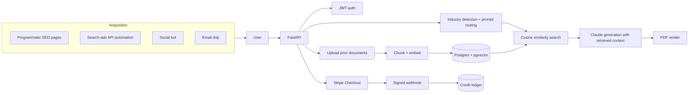

# 05. PrepareQuick: an AI SaaS from 0 to 1

**Role:** founder, product owner and builder. **Status:** a **past product**, retired in early 2026. It is not live. **Stack:** Python, FastAPI, PostgreSQL + pgvector, Claude for generation, OpenAI embeddings, Stripe Checkout + subscriptions + webhooks, JWT auth, WeasyPrint.

## Problem

Job seekers need tailored cover letters, interview prep, resume rewrites and salary-negotiation material. Generic LLM output reads as generic. The bet: **ground generation in the user's own prior documents** and route prompts by industry, then sell it self-serve with a paid-acquisition loop.

## Architecture

## Guardrails and design rules

- **RAG over the user's own documents only.** Retrieval is scoped to the user, so output reflects their real experience instead of inventing it.
- **Industry-specific system prompts** (for example construction, healthcare, trades, logistics, admin) chosen by an industry detector.
- **Stripe webhook signature verification** before any credit is granted.
- **Pluggable source adapters** behind one interface for the job-listing crawler.

## Evidence and metrics

| Metric | Value |
|---|---|
| Revenue, users, conversion | **Not measured to a standard I'd publish.** No figures are quoted |
| Outcome | Pivoted to an AI-services catalogue, then retired |

## What I'd fix (security lessons)

A post-mortem review found issues I would fix before shipping anything like it again. They are listed here because finding them is part of the job:

1. **IDOR on a credits endpoint.** A route took a `user_id` in the path with no auth check, so anyone could read another user's balance. Several generation endpoints also trusted a `user_id` from the request body. **Fix:** derive the user from the verified token only. Never accept an identity from the client.
2. **Non-idempotent webhook credit grant.** A Stripe retry could double-credit an account. **Fix:** store the event or checkout-session ID under a unique constraint and grant inside the same transaction. A replay becomes a no-op. ([ADR 0003](../adr/0003-pre-charge-durability-and-reconciliation.md) is the mature version of this lesson.)
3. **Hardcoded JWT fallback secret.** **Fix:** fail to start if the secret is missing.
4. **Ran as root on a public interface.** **Fix:** non-root service, bind to localhost behind the reverse proxy.
5. **Secrets and customer files lived next to the code.** **Fix:** a secrets manager, a strict `.gitignore`, and user uploads in object storage with retention rules.
6. **Scraping a site against its terms.** **Fix:** official APIs and licensed feeds only.

## What I'd do differently (product)

- **Pick one buyer and one job.** A broad toolkit, then a 10-product pivot, spread a tiny acquisition budget too thin.
- **Instrument the funnel first.** Without trustworthy visit → signup → paid numbers, every pivot was a guess.

## Business impact (for a sales or GTM leader)

- **I've owned a P&L-shaped product end to end:** positioning, pricing, payments, acquisition channels and the shutdown decision.
- **RAG grounded in customer data** is the same pattern enterprise buyers ask for: "use *our* documents, not the internet." I've built it and know where it breaks.
- **Security diligence is part of the sale.** Knowing what an IDOR or a webhook replay is, and how to fix it, shortens every security questionnaire.
