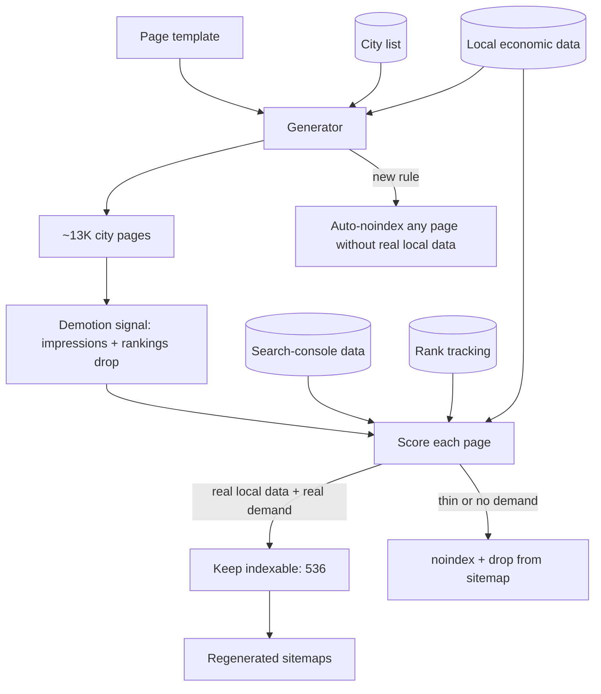

# 06. Programmatic SEO and the prune

**Role:** strategist and builder. **Status:** the pruned site is live. **Stack:** PHP page templates, Python generators, Postgres, rank-tracking and search-console data, sitemaps.

## Problem

A consumer-loan lead-generation affiliate business needed organic traffic in a crowded, regulated category. The classic play is programmatic SEO: one template × products × cities. We generated about **13K** city-level pages across three loan categories.

Then the search engine applied what looked like a **scaled-content demotion**. Thin, near-duplicate pages were dragging down the whole site.

## Architecture

## Guardrails and design rules

- **Data, not opinion, decides what stays.** Each page was scored on whether it had real local data and real search demand. Pages without both were noindexed and removed from sitemaps rather than deleted, so the decision is reversible.
- **The generator learned the lesson.** It now auto-noindexes any page that lacks real local data. The guardrail lives in code, so the mistake can't be repeated at scale.
- **Compliance rules as data.** Copy rules for a regulated category are versioned and checked before publish (see [case study 03](03-governed-agent-ops.md)).

## Evidence and metrics

| Metric | Value |
|---|---|
| Pages generated | **~13K** |
| Pages kept indexable after the prune | **536** |
| Traffic or revenue recovery after the prune | **Not measured** to a standard I'd publish |

## What I'd do differently

- **Start with 500 great pages, not 13,000 thin ones.** Earn the right to scale with evidence that the first pages rank and convert.
- **Set a quality bar per page before generation:** unique data, a real local answer, a reason to exist.
- **Track index coverage and per-template performance weekly**, so a demotion shows up as a trend and not a surprise.

## Business impact (for a sales or GTM leader)

- **Scale is not a strategy.** The same trap shows up in outbound: 10× the sequences with the same thin message gets you filtered. Quality gates beat volume.
- **Cutting is a leadership skill.** Noindexing about 96% of your own pages is uncomfortable. Doing it on data, reversibly, with a code guard so it doesn't recur, is the same discipline as cutting a pipeline stage that doesn't convert.
- **AI-assisted content needs editorial controls.** Every GTM team generating content with LLMs will hit this. I've hit it and have the playbook.
