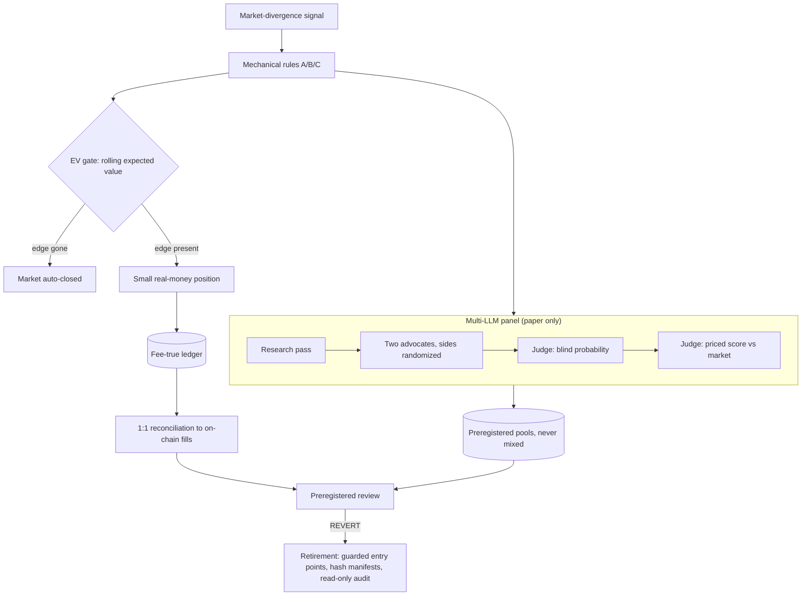

# 07. Killing a strategy with evidence (SharpKing)

**Role:** designer, builder and operator. **Status:** retired, with a full reconciliation. **Stack:** Python (standard library first), prediction-market and exchange APIs, OpenRouter (Claude, GPT, Perplexity), cron, static HTML.

## Problem

SharpKing was a sports prediction-market strategy. It fired mechanical rules on a market-divergence signal and placed small real-money positions behind an expected-value gate. A paper-only multi-LLM panel ranked each play alongside it.

The real question was never "does it make money this week?" It was **"is there a durable edge, and how would we know if there isn't?"**

## Architecture

## Guardrails and design rules

- **Preregistration.** A rule change was written down with its hypothesis, metric and forward period *before* the data came in. An independent verification pass reviewed it. The verdict was REVERT.
- **EV gate.** Markets close automatically when the rolling expected value disappears. Nobody has to decide to stop.
- **Fee-true accounting.** Results are computed after fees and reconciled **1:1** against actual fills, not against the strategy's own log.
- **Debiased LLM panel.** Two advocates argue opposite sides, with sides hash-randomized to cancel advocate bias. The judge commits to a blind probability before it sees the price. A leak guard blocks post-start information. Pools are preregistered and never mixed.
- **Clean retirement.** Every entry point carries an unconditional exit guard. All schedules are disabled. Backups are hash-manifested. A read-only audit confirms nothing runs after cutover.

## Evidence and metrics

| Metric | Value |
|---|---|
| Net result on real stakes (fee-true, reconciled 1:1) | **−8.8%** on small stakes |
| Signal edge after the review period | **None measurable** |
| Preregistered review verdict | **REVERT** |
| Multi-LLM panel | Paper only; sample too small to claim skill |

## What I'd do differently

- **Set the kill criterion on day one.** "Below break-even over N decisions at confidence X means we stop." Writing it down early would have ended the experiment sooner and cheaper.
- **Keep money out until the forward test passes.** Stakes were small by design; with a preregistered forward test first, they could have been zero.
- **Use only sources whose terms allow it** and licensed data feeds, from the start.

## Business impact (for a sales or GTM leader)

- **This is forecast discipline.** Preregistration is what a good sales leader does with a pipeline: define stage criteria before the quarter, not after. Then call the deal lost when the evidence says so.
- **Reconcile to the source of truth.** CRM numbers that don't tie to booked revenue are fiction. The same goes for strategy logs that don't tie to fills.
- **Shutting things down cleanly is a skill.** Guarded entry points, a final reconciliation and a read-only audit are exactly what you want when sunsetting a product, a territory or a vendor.
