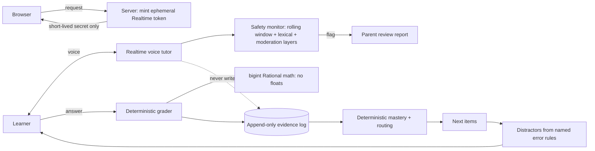

# 08. AI tutor invariants: AI talks, deterministic code grades

**Role:** designer and builder. **Status:** in private use; the code stays private. **Stack:** TypeScript, vitest + fast-check (property tests), OpenAI Realtime for voice, a speech-to-text model for transcription, an LLM SDK for authoring-time content, Postgres/JSONL event store, PWA.

## Problem

Expedition is a single-learner home curriculum engine covering math, reading, history and science, with a realtime voice tutor.

LLMs are great at conversation and bad at being reliably right. In education a wrong grade or a silently skipped lesson is worse than no AI at all. The design question: **where exactly is the model allowed to have authority?**

## Architecture

## Guardrails and design rules

These are written as non-negotiable invariants:

1. **The LLM never grades, never writes mastery, never routes.** It explains and encourages. Code decides what is correct and what comes next.
2. **No floats in math.** All arithmetic uses an exact bigint `Rational` type, so 0.1 + 0.2 is exactly 3/10. Property tests check the algebra.
3. **Every distractor comes from a named error rule** (for example "added the denominators" or "dropped the remainder"). A wrong option is a diagnosis, not noise, and a wrong answer tells you *which* misconception to address.
4. **Ephemeral Realtime tokens.** The API key never reaches the browser. The server mints a short-lived client secret per session.
5. **Safety monitor** on tutor turns, with layered checks and a parent-facing review report.
6. **Append-only evidence log.** Progress is derived from events, never edited.
7. **Works with AI disabled.** The curriculum, grading and routing run without any model. AI is an enhancement, not a dependency.

## Evidence and metrics

| Metric | Value |
|---|---|
| Learning outcomes | **Not measured** and not published |
| Engineering evidence | Property-tested math, a transcription benchmark comparing several speech-to-text models offline, deploy canaries |

Learner data is never published. This case study intentionally contains no learner details.

## What I'd do differently

- **Write the invariants before the first prompt.** I wrote them early, but not first. Each one replaced a class of bugs that had already happened.
- **Benchmark transcription before choosing a model.** The offline benchmark should have come before integration, not after.

## Business impact (for a sales or GTM leader)

- **"Where does the AI have authority?" is the first question in every enterprise deal.** This project has a crisp answer: conversation yes, decisions no. That framing de-risks AI in regulated or high-trust settings such as healthcare, finance and education.
- **Graceful degradation sells.** "It still works if the model is down" ends a lot of procurement objections.
- **Ephemeral credentials** are the right answer to "is our API key exposed in the browser?"
