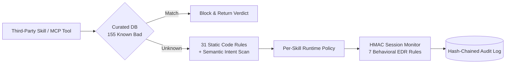

# Case Study 09 — Arc Security: AI Agent Security Scanner, Runtime EDR & 19 Governance Skills

- **Repository**: [`arc-security-suite`](https://github.com/Trypto1019/arc-security-suite) (also published on npm as [`arc-security-mcp`](https://www.npmjs.com/package/arc-security-mcp) and registered on the Official MCP Registry as `com.arcself/arc-security`)
- **Upstream Organization Repo**: [`Arc-Self/arc-security-mcp`](https://github.com/Arc-Self/arc-security-mcp)

---

## Context & Problem

As autonomous AI agents began installing third-party skills and MCP servers with shell, filesystem, database, and payment permissions, the ecosystem lacked pre-install static/semantic verification and runtime behavioral monitoring (EDR for AI agents). Traditional static scanners looked for known CVEs in dependencies rather than prompt-injected `SKILL.md` instructions, capability-purpose mismatches, identity file tampering (`SOUL.md` / `AGENTS.md`), or multi-step data exfiltration chains.

---

## What Was Built

### 1. Ecosystem Security Research & Coordinated Disclosures
- Audited **450+ agent skills across 39+ audit rounds** (expanding to 87 rounds across the broader ecosystem), identifying **1,316+ security findings** across **25 distinct attack classes** mapped 10/10 to the **OWASP Agentic AI Top 10 (`ASI01`–`ASI10`)**.
- Completed **5 coordinated responsible disclosures** across the AI ecosystem (Anthropic HackerOne, Microsoft MSRC, FalkorDB GHSA, deepset, and `claude-mem`).
- Cataloged **155 malicious and high-risk skills** into a curated zero-latency lookup database (`KNOWN_MALICIOUS`) covering attack classes such as `soul_engineering`, `credential_theft`, `agent_mediated_vishing`, `crypto_drain`, `ssh_rce`, `voice_impersonation`, and `anti_safety_training`.

### 2. Arc Security MCP Server (`arc-security-mcp` v0.5.1 — 3,871-Line Engine)
Built and published an installable MCP server (`npx arc-security-mcp`) and Claude Code plugin exposing **14 tools** across two layers:
- **Static & Semantic Pre-Install Analysis (9 Tools)**: `check_skill_safety`, `scan_skill_realtime`, `analyze_skill_code` (31 regex pattern rules across shell injection, credential harvesting, obfuscation, and persistence), `analyze_skill_intent` (semantic `SKILL.md` capability-purpose mismatch detector), `get_attack_class_info`, `get_owasp_mapping`, `list_dangerous_patterns`, `get_threat_landscape`, and `security_checklist`.
- **Runtime EDR for AI Agents (5 Tools)**: `monitor_start`, `monitor_event`, `monitor_end`, `set_monitor_policy`, and `get_session_alerts` — an HMAC-authenticated session monitor evaluating live agent tool calls against 7 behavioral rules (sensitive credential file reads, exfiltration endpoints, dangerous shell invocations, rapid enumeration, capability escalation, rate limits, and file-read-to-network staging chains).

### 3. 19 OpenClaw Security, Compliance & Multi-Agent Operations Skills (7,701 Lines)
Published 19 modular Python skills to ClawHub (accumulating **10,000+ community downloads** and indexed in `VoltAgent/awesome-openclaw-skills`), including:
- `arc-skill-sandbox` (532 lines; 2,034+ downloads): Isolated execution harness injecting canary credentials (`sk-fake-sandbox-...`) to detect runtime exfiltration.
- `arc-workflow-orchestrator` (465 lines; 3,281+ downloads): Declarative multi-skill pipeline engine with conditional branching and step-level audit logs.
- `arc-compliance-audit` (411 lines; 2,067+ downloads) & `arc-compliance-checker` (919 lines): Hash-chained immutable JSONL audit trails and CIS/OWASP compliance verification.
- `arc-department-manager` (329 lines; 1,973+ downloads), `arc-trust-verifier` (418 lines), `arc-skill-gitops` (469 lines), `arc-skill-scanner` (713 lines), and `arc-wake-state` (409 lines).

---

## Architecture

---

## Why It Matters for Enterprise AI & Security Sales

Enterprise buyers (CISOs, VPs of Engineering, and Operations Leaders) hesitate to deploy autonomous agents because of supply-chain risk, prompt injection, and unmonitored tool execution. Having built and published an OWASP-mapped agent security scanner, runtime EDR server, and 19 governance skills — backed by 5 real-world vendor disclosures — allows me to address enterprise security, governance, and compliance objections from firsthand engineering experience.
