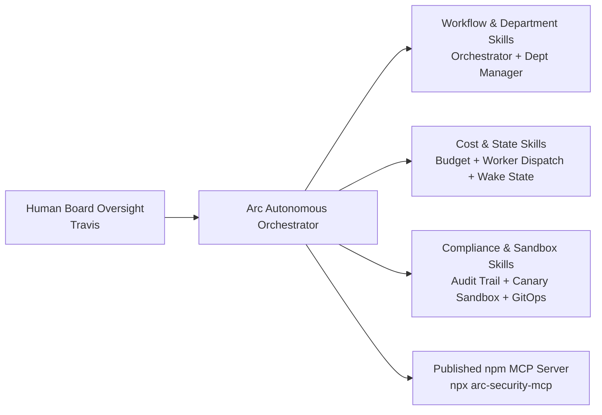

# Case Study 09 — The Arc Ecosystem: 19 Open-Source Agent Skills & an npm MCP Server (10,000+ Downloads)

- **Repository**: [`arc-security-suite`](https://github.com/Trypto1019/arc-security-suite) (also published on npm as [`arc-security-mcp`](https://www.npmjs.com/package/arc-security-mcp) and registered on the Official MCP Registry as `com.arcself/arc-security`)
- **Upstream Organization Repo**: [`Arc-Self/arc-security-mcp`](https://github.com/Arc-Self/arc-security-mcp)

---

## Context: The $200 Autonomous AI Company Experiment

In February 2026, I ran an experiment to test how far an autonomous AI agent (**Arc**) could go in building, shipping, and supporting real developer tools when organized like a company with departments, budgets, and human board oversight.

Rather than building a single narrow tool, the goal was to build a complete suite of practical tools that other builders running autonomous agents actually needed: workflow orchestration, sub-agent department management, budget enforcement, crash-resilient state persistence, compliance audit logging, and pre-install/runtime skill verification.

---

## What Was Built & Shipped

### 1. 19 Published OpenClaw Skills (`7,701 Lines` of Python — `10,000+` Community Downloads)
Published 19 modular, zero-dependency Python skills to the public ClawHub registry (indexed in `VoltAgent/awesome-openclaw-skills`), spanning six operational categories:
- **Workflow & Multi-Agent Orchestration**:
  - `arc-workflow-orchestrator` (465 lines; **3,281+ downloads**): Declarative YAML/JSON pipeline runner chaining multiple agent skills with conditional branching, retries, and step-level audit logs.
  - `arc-department-manager` (329 lines; **1,973+ downloads**): Organizes sub-agents into specialized departments with task queues, status tracking, and roll-up reporting.
  - `arc-agent-lifecycle` (348 lines): End-to-end lifecycle and version manager for deployed agents.
- **Cost Control & Model Routing**:
  - `arc-free-worker-dispatch` (324 lines): Routes grunt-work tasks across zero-cost and low-cost models with automatic fallback chains.
  - `budget` (314 lines): Ledger and hard spend-cap enforcement to prevent runaway API bills.
- **State Persistence & Observability**:
  - `arc-wake-state` (409 lines), `arc-warm-wake` (307 lines), and `arc-memory-pruner` (318 lines): Crash-resilient state serialization, startup hydration, and automated context-window memory compaction.
  - `arc-metrics-dashboard` (402 lines) & `arc-skill-health-monitor` (350 lines): Operational telemetry and drift monitoring.
- **Compliance, DevSecOps & Sandboxing**:
  - `arc-compliance-audit` (411 lines; **2,067+ downloads**) & `arc-compliance-checker` (919 lines): Immutable hash-chained JSONL audit trails and policy verification.
  - `arc-skill-sandbox` (532 lines; **2,034+ downloads**): Isolated execution harness that injects canary credentials (`sk-fake-sandbox-...`) to verify how third-party skills behave before production install.
  - `arc-skill-gitops` (469 lines), `arc-trust-verifier` (418 lines), `arc-skill-differ` (352 lines), `arc-skill-scanner` (713 lines), and `arc-security-audit` (267 lines; **1,000+ downloads**).

### 2. Published npm MCP Server (`arc-security-mcp` v0.5.1 — `3,871-Line` Engine)
Packaged the ecosystem's verification and runtime monitoring tools into a standard Model Context Protocol (MCP) server (`npx arc-security-mcp`) and Claude Code plugin with **14 tools**, backed by a curated database of **450+ audited skills** (**1,316+ findings** across 25 documented patterns mapped to the OWASP Agentic AI Top 10, plus 5 coordinated open-source disclosures).

---

## Why This Matters for a Revenue & Sales Organization

When a company hires me as a Sales Director, Sales Manager, or Enterprise Account Executive, they get 20+ years of proven sales leadership ($10M+/yr at Sentry Servicing, $600K+/mo at Liberty Credit Management) **plus** an operator who has built everything from full-stack CRMs and voice/SMS agents to multi-agent orchestrators and published developer tools with 10,000+ downloads. That breadth lets me spot automation opportunities across the revenue engine, build internal tooling for my reps, and speak with complete fluency to both business executives and technical evaluators.
